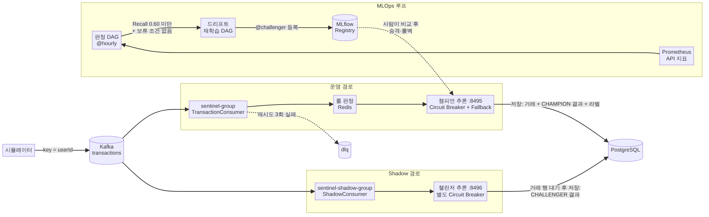

# Sentinel-ML — 핵심 구현 포인트

실시간 이상거래 탐지 파이프라인(Kafka → Redis 룰 → ML 서빙 → PostgreSQL)에 Shadow Deployment와 드리프트 재학습 루프를 붙인 개인 프로젝트입니다.
아래 네 가지는 직접 문제를 정의하고, 대안을 비교해 고르고, 결과를 측정한 사례입니다. 수치는 모두 단일 PC·시뮬레이터 트래픽 기준입니다.

| 사례 | 한 줄 요약 | 핵심 수치 |
|---|---|---|
| [A](#a-두-consumer-group-사이의-외래키-경쟁) | 두 consumer group 사이의 외래키 경쟁을 "대기 후 저장, 없으면 건너뛰고 집계"로 풀고, 챌린저 장애가 운영 경로로 번지지 않게 격리 | 외래키 대기 평균 57.7ms · 최대 82.3ms, 저장 누락 0건 (5,054건) |
| [B](#b-반복된-운영-사고를-판정-규칙으로-막기) | 같은 종류의 운영 사고가 반복되자 절차 문서 대신 판정 규칙을 3단계로 바꿔 차단 | 사고 4회. 재학습이 `@challenger` 로만 등록되도록 바꾼 뒤의 3회는 모두 champion 불변 |
| [C](#c-실시간-recall-099-가-데이터-누수였음을-확인하고-서빙-구조-교체) | 실시간 Recall 0.99 가 학습 데이터 누수 때문임을 확인하고 서빙을 "재학습 champion + 같은 run 의 전처리" 로 교체 | Recall 0.9865 → 0.8198 (오프라인 0.8133 과 같은 수준) |
| [D](#d-시간대-없는-시각-컬럼-전환) | 시간대 없는 시각 컬럼 때문에 9시간 어긋나던 조회를, 변환 규칙을 데이터로 검증한 뒤 일괄 전환 | `now()` 기준 "미래" 거래 9,689건 → 0건 (기존 거래 157,472건 변환) |

> 부하 시험(k6)과 장애 주입 시험은 아직 하지 않았습니다. 무엇을 검증했고 무엇을 하지 않았는지는 [검증 범위](#검증-범위)에 따로 적었습니다.

그림 원본: [diagrams/architecture.mmd](diagrams/architecture.mmd) (Mermaid)

---

## A. 두 consumer group 사이의 외래키 경쟁

### 문제 정의
- 재학습한 모델(챌린저)을 바로 운영에 올리지 않고, 같은 실거래를 챔피언과 나란히 판단시켜 비교해야 했습니다. 거래별 결과를 `FRAUD_RESULTS` 에 남겨 **같은 거래끼리** 비교하는 것이 목표였습니다.
- 운영 경로를 바꾸지 않도록, 같은 `transactions` 토픽을 별도 consumer group(`sentinel-shadow-group`)으로 읽게 했습니다 (설계 단계 계획: "동일 이벤트를 두 Consumer 그룹에 라우팅").
- 그런데 두 group 은 서로 독립이라 **챌린저 결과의 INSERT 가 거래 행 INSERT 보다 먼저 도착할 수 있습니다** → `FRAUD_RESULTS.TRANSACTION_ID` 외래키 위반.

### 검토한 대안
| 안 | 장점 | 단점 | 판단 |
|---|---|---|---|
| 운영 처리 후 별도 토픽(`scored-transactions`)에 다시 발행, Shadow 는 그 토픽을 소비 | 순서 보장, 비교 모집단 일치 | 챔피언 처리가 멈추면 Shadow 도 멈춤, 계획("같은 이벤트를 두 group 에")과 다름 | 기각 |
| **별도 group + 거래 행이 생길 때까지 짧게 대기 후 저장, 상한을 넘기면 건너뛰고 집계** | 운영 경로 무변경, 두 경로 독립 | 순서 보장이 아니라 대기. 상한 초과 시 결과 누락 | **채택** |

- 대기 간격은 처음에 200ms 로 잡았다가 바꿨습니다. 간격만큼 리스너 스레드가 묶이면 파티션당 초당 약 5건(1,000 ÷ 200)으로 처리량이 제한되어 시뮬레이터의 초당 10건을 따라가지 못합니다 → **50ms 간격, 최대 2초**, Shadow 리스너 concurrency 3.

### 운영 경로를 지키기 위한 격리
| 위험 | 대응 |
|---|---|
| 챌린저 장애가 챔피언의 Circuit Breaker 를 연다 (기존 클라이언트는 CB 이름이 상수로 붙은 단일 빈이라, 같은 클래스로 빈을 하나 더 만들면 상태를 공유) | 챌린저 전용 클라이언트와 CB `challengerScoreClient` |
| Shadow 실패가 운영 DLQ 를 오염시키거나 재시도로 지연된다 | Shadow 전용 리스너 팩토리: 재시도 0회, DLQ 없음, 로그·지표만 |
| Shadow 가 Redis 카운터를 같이 올리면 고빈도 룰이 두 배로 걸려 **실제 판정이 바뀐다** | Shadow 는 Redis·룰·상태 결정을 하지 않음 |
| 챌린저 집계가 판정 DAG 의 Recall 합계에 섞인다 | 지표 분리 `sentinel.ml.shadow.predictions{outcome}` (기존 지표 무변경) |
| 애플리케이션 기본값 `auto-offset-reset: earliest` 때문에 새 group 이 과거 거래 전체를 다시 읽는다 | Shadow group 만 `auto.offset.reset=latest` |
| 서빙만 재기동하면 API 가 캐시한 옛 모델 버전으로 결과를 기록한다 | `/predict` 응답에 실제로 점수를 낸 모델명·버전·run_id 를 싣고, 그 값으로 `MODEL_METADATA` 를 조회/등록 |
| 같은 모델 버전이 챌린저였다가 승격 후 챔피언이 된다 | `FRAUD_RESULTS.ROLE` (`CHAMPION` / `CHALLENGER`) |

### 결과
- 10/9 (원본 데이터): Shadow 결과 **5,054건**, 외래키 대기 평균 **57.7ms** (291,598.08ms ÷ 5,054), 최대 **82.3ms**. 2초 상한에 닿은 적 없음. 저장 생략·오류 지표는 한 번도 생성되지 않음(0건), Shadow LAG 0
- 챔피언이 판단한 거래 4,241건 전부에 챌린저 결과가 짝지어졌고, 판단 일치는 99.06% (4,201 / 4,241)
- 10/17: 같은 v16 이 CHALLENGER 로 11,253행 기록되다가 승격 후 CHAMPION 으로 3,522행 기록됨 → 역할 컬럼이 필요했던 이유가 실제 기록으로 확인됨
- 10/18: 정답 라벨 기준 같은 거래 비교 리포트 → 원본 데이터 구간은 두 모델 **동등**(Recall 0.8137 vs 0.8248, 95% 구간 겹침)이라고 결론 ([리포트](reports/shadow_2026-10-18.md))

### 한계
- 대기 방식은 순서를 보장하지 않습니다. 챔피언 Consumer 가 2초 넘게 밀리면 챌린저 결과는 누락됩니다 (누락은 지표로 셉니다)
- 10/9 측정 당시의 토픽 파티션 수는 기록하지 않았습니다. 10/17 에 `transactions` 가 1파티션으로 운영되고 있던 것을 발견해 3파티션으로 다시 만들었습니다
- 초당 10건, 단일 PC 입니다. 부하 시험 전입니다

**증거**: [ShadowConsumer](../api/src/main/java/com/sentinel/api/consumer/ShadowConsumer.java) · [KafkaConfig](../api/src/main/java/com/sentinel/api/config/KafkaConfig.java) · [ChallengerScoreClient](../ml-client/src/main/java/com/sentinel/mlclient/ChallengerScoreClient.java) · 커밋 [`a5b0c1e`](https://github.com/Min-Ssong/sentinel-ml/commit/a5b0c1e) [`5ef5df9`](https://github.com/Min-Ssong/sentinel-ml/commit/5ef5df9)

---

## B. 반복된 운영 사고를 판정 규칙으로 막기

### 배경
판정 DAG(@hourly)는 최근 1시간 Recall 이 0.60 미만이면 드리프트 재학습을 트리거합니다. 시험은 사람이 DAG 를 수동 실행하거나 일시정지·재개하며 진행했습니다.

### 사고 4회
| # | 시점 (KST) | 무엇이 일어났나 | 결과 | 원인 |
|---|---|---|---|---|
| 1 | 10/5 18:17 | 수동 실행 폼의 시험용 `cooldown_hours=0` 으로 실행 (이전 값 잔류로 추정) | 재학습 → v14 가 `@champion` 으로 자동 승격 (서빙을 재기동하지 않아 트래픽 영향은 없었음) | 폼의 시험 파라미터 |
| 2 | 10/14 오전 | 폼의 `force_trigger=True` 로 실행 (잔류인지 직접 입력인지 미확인) | 보류 조건은 동작했지만 `force_trigger` 가 설계대로 무시 → 검증 중이던 챌린저 v15 를 v16 이 교체 | 폼의 시험 파라미터 |
| 3 | 10/17 15:21 | 시험 후 DAG 재개 → 밀려 있던 15:00 스케줄 실행이 1시간 창 안의 드리프트 트래픽을 봄 (Recall 0.5050) | v17 → `@challenger` | 판정 창에 남은 변경 전 트래픽 |
| 4 | 10/18 12:07 | 같은 유형. 3번 뒤 교훈을 문서에 적었는데도 재발 | v18 → `@challenger` | 같음 |

### 대응: 피해 범위 → 우회 경로 → 발생 조건 순서로 좁힘
| 단계 | 변경 | 효과 |
|---|---|---|
| 피해 범위 | (10/9, Shadow 설계) 재학습은 `@challenger` 로만 등록. 승격·롤백은 사람이 비교 후 `promote_challenger.py` 로 (기본 dry-run, `--apply` 필요) | 이후 사고 2~4 는 모두 "챌린저 1개 생성/교체"로 끝나고 champion 은 바뀌지 않음 |
| 우회 경로 | (10/17) 보류를 **고정 보류**(서빙 ≠ champion, 조회 실패, 챌린저 검증 중)와 **시간 보류**(쿨다운)로 나누고, `force_trigger` 는 Recall 조건과 시간 보류만 우회. 실행 파라미터가 기본값과 다르면 `[warn]` | 사고 2 상황 재현 → `trigger=False` |
| 발생 조건 | (10/18) 마지막 alias 변경(모델 버전 태그 `promoted_at` · `rejected_at` · `rolled_back_at` 중 최신) 후 **판정 창 길이**가 지나기 전이면 보류. 원인이 "창 안의 변경 전 트래픽"이라 창이 지나면 원인이 사라지므로 고정 시간 대신 창 길이를 씀 | 사고 4 상황 재현 → `trigger=False`. 실제 MLflow 첫 실행에서 `last_alias_change='rejected_at@v18'` 조회 확인 |

### 한계
- 네 번 모두 개인 시험 환경에서 사람이 낸 사고입니다
- alias 변경 없이 드리프트 트래픽 직후 재개하는 경우는 여전히 막지 못합니다. `cooldown_hours=0` 잔류 + 실제 Recall 저하도 트리거됩니다 (대신 `[warn]` 이 남습니다)
- 근본 원인(판정 창에 과거 트래픽이 섞이는 것)은 그대로입니다
- 위 재현 확인은 Airflow·MLflow 를 대체한 로컬 단위 확인이고, 아직 저장소에 테스트로 넣지 않았습니다

**증거**: [판정 DAG](../infra/docker/airflow/dags/sentinel_drift_monitor.py) · [promote_challenger.py](../ml/promote_challenger.py) · 커밋 [`a669432`](https://github.com/Min-Ssong/sentinel-ml/commit/a669432) (챌린저 등록·수동 승격) [`170f634`](https://github.com/Min-Ssong/sentinel-ml/commit/170f634) (고정/시간 보류) [`3b289e2`](https://github.com/Min-Ssong/sentinel-ml/commit/3b289e2) (alias 변경 보류)

---

## C. 실시간 Recall 0.99 가 데이터 누수였음을 확인하고 서빙 구조 교체

### 상황
시뮬레이터 트래픽의 실시간 Recall 이 0.98~0.99 였고 (10/3 292 / 296 = 0.9865), 10/4 에는 이 값을 근거로 재학습 임계값을 0.90 으로 정했습니다.

### 발견 (10/5)
1. 서빙은 6월에 만든 `sentinel-fraud/latest`(v4)를 로드하고 있었고, 재학습 DAG 의 champion 은 별도 모델 `sentinel-fraud-dag@champion`(v12)이었습니다. 재학습이 champion 을 바꿔도 서빙에는 반영되지 않는 구조였습니다
2. v4 는 전체 데이터를 **랜덤 분할**해 학습했습니다. 시뮬레이터는 시간순 마지막 20%(holdout)를 보내므로, holdout 행의 약 80%가 v4 학습에 이미 들어 있었습니다 (사기 75건 중 기대값 약 60건)
3. 서빙의 전처리(`scaler.pkl`)도 v4 용이라 v12 와 맞지 않았고, 재학습 DAG 는 전처리를 저장하지 않고 있었습니다

| holdout 56,962행 (사기 75건) | AUC | Recall@0.5 |
|---|---|---|
| v4 (당시 서빙) | 0.9986 | 0.9867 (74/75) |
| v12 (재학습 champion) | 0.9824 | 0.8133 (61/75) |

### 조치
- 서빙이 `@champion` 을 조회해 **그 버전의 모델과 같은 run 의 전처리**를 함께 로드하도록 변경
- 전처리는 pickle 대신 JSON(mean, scale). 학습(Airflow 컨테이너)과 서빙(로컬 venv)의 scikit-learn 버전이 다를 수 있어서입니다 (실제로 6월에 1.8.0 으로 만든 `scaler.pkl` 을 1.9.0 에서 읽을 때 버전 경고 발생)
- v12 에는 전처리를 재현해 보충했습니다. 재현값으로 계산한 AUC 가 기록값과 **전체 자릿수까지 일치(차이 0)**했고, 기존 `scaler.pkl` 은 2.824e-05 달라 두 후보를 구분했습니다
- 근거가 무효가 된 임계값 0.90 을 다시 정했습니다: Wilson 95% 구간에서 기준(v12) 하한 0.7107 과 드리프트(S2) 상한 0.473 사이 → **0.60**

### 결과
- 서빙만 교체했을 때 실시간 Recall **0.8198** (713.72 / 870.57) — 오프라인 0.8133 과 같은 수준이고, 약 0.17 하락이 누수 설명과 맞음
- 이 교체로 "드리프트 감지 → 재학습 → 승격 → 서빙 반영 → 회복(0.37 → 0.95)" 루프가 처음으로 이어짐 (S2 합성 시나리오)

### 한계
- 사기 표본이 75건이고 반복 추출이라 구간은 낙관적입니다. 드리프트(S2)는 합성 시나리오입니다
- "Recall 99%" 는 누수 값이라 어디에도 성과로 쓰지 않습니다

**증거**: [compare_serving_models.py](../ml/compare_serving_models.py) · [serving/app.py](../ml/serving/app.py) · [backfill_champion_scaler.py](../ml/backfill_champion_scaler.py) · 커밋 [`229c2ed`](https://github.com/Min-Ssong/sentinel-ml/commit/229c2ed) (서빙 전환) [`6ed980d`](https://github.com/Min-Ssong/sentinel-ml/commit/6ed980d) (DAG 전처리 저장) [`e357610`](https://github.com/Min-Ssong/sentinel-ml/commit/e357610) (판정 규칙)

---

## D. 시간대 없는 시각 컬럼 전환

### 문제 정의
- 시각 컬럼이 `TIMESTAMP`(시간대 없음)였고, JPA Auditing 이 JVM 시각(KST `LocalDateTime`)을 넣고 있었습니다. DB 세션은 UTC 라 `now()` 기준 조회가 9시간 어긋났습니다. 설계 문서(ERD)에는 "UTC" 로 적혀 있어 문서와 구현도 달랐습니다
- 전환 직전 실측: DB 시각 08:31 UTC 기준으로 `created_at > now()` 인 **"미래" 거래 9,689건**

### 검토한 대안
| 안 | 판단 |
|---|---|
| DB 세션 시간대를 KST 로 맞춤 | 기각. 저장값에 시간대 정보가 없는 것은 그대로라, 나중에 JVM 시간대가 바뀌면 KST·UTC 값이 섞여도 구분할 수 없음 |
| **`TIMESTAMPTZ` + Java `Instant`** | 채택. 이미 정답 라벨 테이블(`LABELED_AT`)이 이 방식으로 `ddl-auto: validate` 를 통과하고 있었음 |

### 변환 규칙을 먼저 데이터로 검증
기존 값을 "KST 로 해석해 변환(`AT TIME ZONE 'Asia/Seoul'`)"하는 규칙이 맞는지, 변환 전에 확인했습니다.
| 확인 | 결과 |
|---|---|
| 이미 정확했던 라벨 시각과 같은 거래의 `created_at` 을 KST 로 읽어 비교 | 10,780건 차이 0 ~ 0.198초 → 저장값은 KST |
| 라벨이 없던 이전 거래 157,472건: `created_at − timestamp` | 0.0025 ~ 742.96초, −1분 미만 0건 (DB 기본값 `now()` 로 들어간 UTC 행이 있었다면 −9시간 근처) |
| 판단 결과 89,301건 vs 거래 | 0 ~ 0.265초, 음수 0건 |
| 모델 등록 시각 (v15) | 재학습 run ID(UTC 시각 포함)와 KST 기준으로 일치 |

### 배포 순서 (계약 변경 포함)
- Kafka 메시지의 `timestamp` 도 `Instant` 로 바뀌는 **계약 변경**이라, 생산자·소비자를 모두 멈추고 두 consumer group 의 lag 가 0 인 것(옛 형식 메시지 없음)을 확인한 뒤 적용
- 백업(`pg_dump`) → 단일 트랜잭션 `ALTER ... TYPE timestamptz` → 같은 쿼리로 재검증 → 새 코드 기동
- 되돌리기는 역변환 SQL 로 준비했습니다. **MLflow 저장소가 같은 DB 를 쓰고 있어** 백업 전체를 복원하면 MLflow 변경까지 되돌아가기 때문입니다. 역변환은 로컬 PostgreSQL 에서 시험 데이터로 정방향 → 역방향 → 정방향 왕복해 값이 같은 것을 확인했습니다
- `@CreatedDate` 값은 `DateTimeProvider` 로 `Instant.now()` 를 직접 공급해, 기본 공급자의 "LocalDateTime 생성 → JVM 시간대로 변환" 경로를 없앴습니다

### 결과
| 확인 | 전환 전 | 전환 후 |
|---|---|---|
| `created_at > now()` 인 거래 | 9,689 | **0** |
| 라벨 시각 대비 차이 (10,780건) | 0 ~ 0.198초 (KST 변환 필요) | 0 ~ 0.198초 (변환 없이) |
| 판단 결과 대비 차이 (89,301건) | 0 ~ 0.265초 | 0 ~ 0.265초 |
| 새 코드로 2분 실행 | - | 새 거래 1,073건, `created_at − timestamp` 0.004 ~ 1.23초, 미래 0건 |

### 한계
- 다운타임을 허용한 전환입니다 (`ALTER TYPE` 은 테이블을 다시 쓰고 잠급니다). 무중단 전환(새 컬럼 추가 → 이중 기록 → 백필 → 읽기 전환)은 하지 않았습니다
- 메시지의 `timestamp` 는 epoch 초 숫자로 직렬화됩니다. Java 소비자끼리는 문제없지만, 다른 언어 소비자가 붙는다면 ISO-8601 문자열이 낫습니다

**증거**: [마이그레이션 SQL](sql/migration_2026-10-18_timestamptz.sql) · [JpaConfig](../api/src/main/java/com/sentinel/api/config/JpaConfig.java) · [Transaction 엔티티](../domain/src/main/java/com/sentinel/domain/entity/Transaction.java) · 커밋 [`a455e30`](https://github.com/Min-Ssong/sentinel-ml/commit/a455e30)

---

## 그 밖의 설계 결정 (요약)
| 결정 | 이유 |
|---|---|
| Kafka 파티션 키 = `userId` | 같은 사용자의 거래를 같은 파티션으로 보내 고빈도 룰 판단의 순서를 지킴 |
| 처리 실패: 3초 간격 3회 재시도 후 DLQ | 일시 장애는 재시도로 흡수, 실패 원본은 보존 |
| ML 서버 장애: Circuit Breaker + Fallback(룰 결과로 처리) | ML 장애가 거래 처리를 멈추지 않게 함 (설계·구현까지, 장애 주입 시험 전) |
| 정답 라벨을 거래와 분리한 테이블 | 실제 확정 라벨(차지백·신고)은 거래보다 늦게 도착함. 지금은 즉시 저장하지만 구조는 지연 도착을 표현 |
| PSI 는 경보만, 재학습은 Recall 로 판정 | 오프라인 실험에서 PSI 0.904 의 데이터 드리프트에도 champion 성능이 변하지 않음 |
| 성능 게이트는 champion 도 같은 평가셋으로 다시 평가 | 기록된 옛 점수와 비교하면 서로 다른 시험지 점수를 비교하게 됨 |
| 거래 ID 기반 MDC 추적 로깅 | 한 거래의 흐름을 Consumer → ML 서빙 → DB 까지 같은 ID 로 추적 |

## 검증 범위
| 검증한 것 | 하지 않은 것 |
|---|---|
| Shadow 저장 경로(외래키 대기·누락·역할 기록), 수동 승격·롤백과 Recall 회복, 판정 보류 규칙, 시간대 전환 전후 대조 | **k6 부하 시험 (P95 SLA)** |
| 드리프트 감지 → 재학습 → 게이트 → 등록 경로 (S2 합성 시나리오) | **장애 주입 시험** (ML 서버 다운, Redis 차단, Kafka 재시작) |
| 같은 거래·정답 라벨 기준 모델 비교 리포트 | ML 호출 타임아웃 설정(5,000ms)과 SLA 의 정합성 재검토 |
| | 다중 노드, 무중단 배포, 서빙 자동 재로드 (지금은 alias 변경 후 재기동) |
| | 실제 사기 패턴 변화 (S2 는 합성), 라벨 지연 도착 (즉시 도착 가정), 실제 수준의 Precision (시뮬레이터 사기 비율 0.5) |

실행 방법은 [README](../README.md) 에 있습니다.
